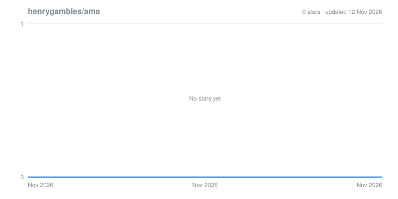

# Ask me anything

Ask me anything: code, projects, music, faith, books, whatever you're curious about.

### How it works

1. [Open a new issue](https://github.com/henrygambles/ama/issues/new/choose) with your question
2. I'll answer it in the issue
3. Closed issues are answered questions. [Browse them](https://github.com/henrygambles/ama/issues?q=is%3Aissue+is%3Aclosed)

### Ground rules

- Search first, as your question might already be answered
- One question per issue, with a clear title
- Be kind. Anything abusive gets closed

Want to improve this page? Pull requests are welcome too.

*Inspired by [sindresorhus/ama](https://github.com/sindresorhus/ama).*

## Star History

